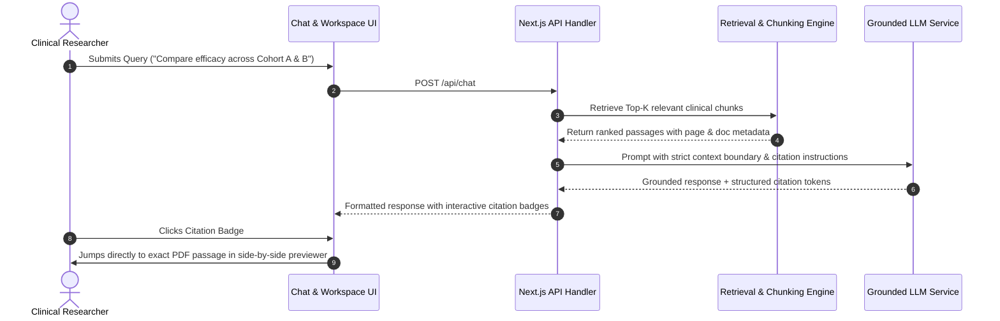

# Clinical AI Grounding & Verification Workflow Guide — PharmaResearch AI

## 1. The "Ask, Ground, Verify" Architecture

In high-assurance pharmaceutical research, ungrounded generative AI risks producing misleading trial synthesis and dosage hallucinations. PharmaResearch AI implements a rigorous **Ask, Ground, Verify** framework:



---

## 2. Document Chunking & Ingestion Protocol

1. **PDF Text Extraction**: Extracts structured text layer while preserving page numbering and paragraph offsets.
2. **Chunk Sizing**: Chunks are generated with 500-token windows and 50-token overlapping boundaries to maintain semantic continuity across section headers.
3. **Citation Metadata Tagging**: Every chunk retains immutable provenance:
   - `documentId`: Foreign key to `Document` record.
   - `documentTitle`: Human-readable file name.
   - `pageNumber`: Physical PDF page index.
   - `chunkIndex`: Sequential position in the source document.

---

## 3. Strict Prompt Grounding & Hallucination Defense

The system prompt enforces zero-tolerance hallucination boundaries:

```text
You are PharmaResearch AI, a clinical research assistant.
Instructions:
1. Answer the question using ONLY the provided source passages below.
2. Do not infer or assume any information not explicitly present in the text.
3. If the context does not contain sufficient clinical evidence, respond with:
   "The uploaded document does not contain evidence to answer this question."
4. Every factual statement must cite its source using the format [Document Name, Page #].
```

---

## 4. Human-in-the-Loop Evidence Verification

- **Interactive Citation Badges**: Rendered inline as clickable components (`[CSR-Study-01, Page 12]`).
- **Split-Screen Reviewer**: Clicking any citation immediately loads the original PDF in the side-by-side viewer with the exact passage highlighted for immediate clinical validation.
