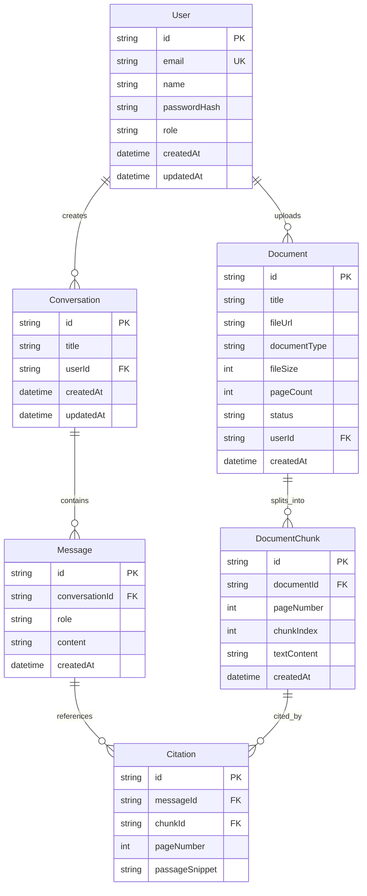

# Database Schema & Data Modeling Guide — PharmaResearch AI

## 1. Overview & Technology
PharmaResearch AI uses **PostgreSQL** as the primary relational database with **Prisma ORM** for schema definition, client generation, and database migrations.

---

## 2. Entity Relationship Diagram



---

## 3. Data Models & Constraints

### 3.1 User
- Represents authenticated researchers, reviewers, and system administrators.
- `email`: Indexed, unique constraint, sanitized lowercase.
- `role`: Enum (`RESEARCHER`, `REVIEWER`, `ADMIN`).

### 3.2 Document
- Represents an ingested clinical trial document (CSR, label, bulletin).
- `fileSize`: Enforced max 10MB (10,485,760 bytes).
- `status`: Enum (`PENDING`, `PROCESSING`, `READY`, `FAILED`).

### 3.3 DocumentChunk
- Represents indexed text blocks for semantic retrieval.
- Average chunk size: 500 tokens with 50-token overlap.

### 3.4 Conversation & Message
- Stores multi-turn clinical chat histories.
- Cascade delete enabled: Deleting a conversation removes all associated messages and citations.

---

## 4. Migration & Schema Workflow

To modify the database schema:

```bash
# Apply schema changes to local development DB
npm run db:push

# Generate new migration for version control
npm run db:migrate

# Regenerate Prisma client types
npm run db:generate

# Launch Prisma Studio GUI inspector
npm run db:studio
```
