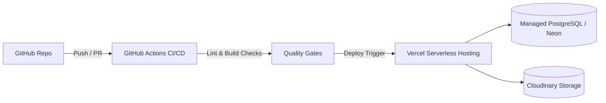

# Deployment & CI/CD DevOps Guide — PharmaResearch AI

## 1. Hosting Architecture Overview

PharmaResearch AI is architected for deployment across serverless edge platforms (Vercel) or containerized environments (Docker / AWS ECS / Google Cloud Run).

---

## 2. Vercel Production Deployment

### 2.1 Project Configuration
1. Connect the GitHub repository to your Vercel team dashboard.
2. Set the **Root Directory** to `pharma-research-ai`.
3. Framework preset will automatically detect **Next.js**.

### 2.2 Production Environment Variables
Configure the following in the Vercel dashboard:
- `DATABASE_URL`: Connection string with pooling support (e.g., Supabase / Neon / AWS RDS).
- `JWT_SECRET`: 256-bit cryptographically secure secret.
- `CLOUDINARY_CLOUD_NAME`, `CLOUDINARY_API_KEY`, `CLOUDINARY_API_SECRET`.
- `GROQ_API_KEY`: API key for LLM inference.

### 2.3 Build Commands
- **Build Command**: `npm run db:generate && next build`
- **Output Directory**: `.next`
- **Install Command**: `npm ci`

---

## 3. GitHub Actions CI Automation

The repository includes continuous integration (`.github/workflows/ci.yml`) triggering on pushes to `main` and all pull requests:

- **Parallelized Jobs**: Dependency verification, lint checks, type safety, and production build validation.
- **Strict Lockfile Enforced**: Uses `npm ci` to ensure reproducible builds.
